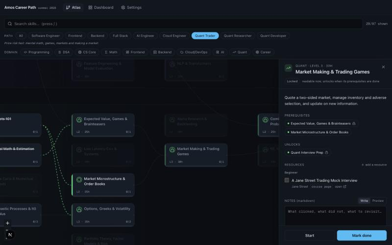
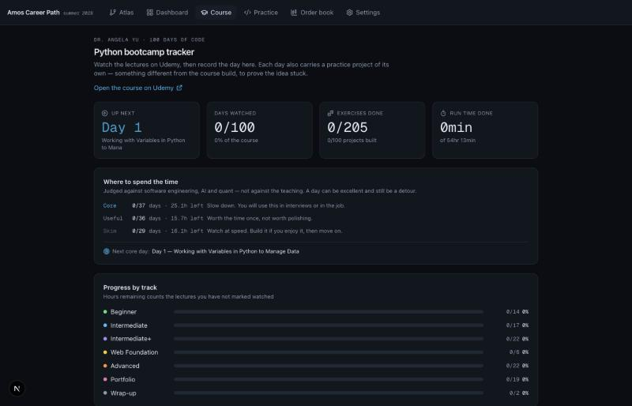
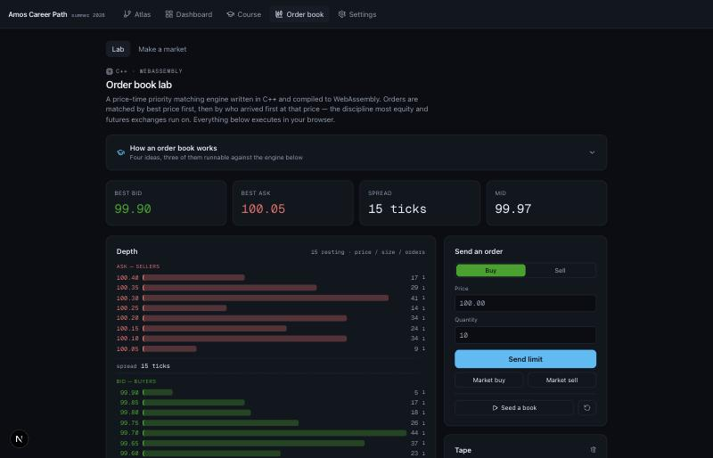
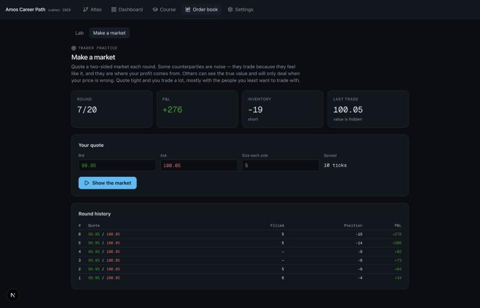
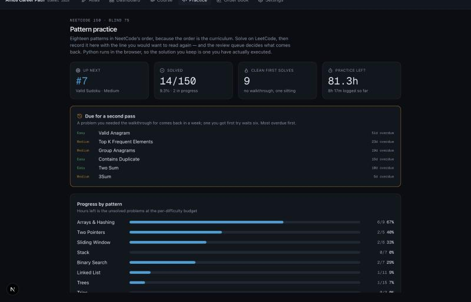

# Amos Career Path

One place to get technically ready for **summer 2028 internship recruiting**,
which opens around **1 August 2027** — software engineering, AI, and the three
quant tracks.

It started as a skill map and grew into the tools that map implies: a prerequisite
graph of 97 skills, a dashboard that knows how far behind I am, a tracker for the
Python bootcamp I am working through, and a matching engine written in C++ so the
microstructure nodes on the map are something I have built rather than read about.

Progress lives in `localStorage`. Content lives in typed data files in the repo.
There is no backend.

```
TypeScript · Python · C++ · WebAssembly · 311 unit tests · 72 C++ assertions
```




## Why I built this

*(Placeholder — rewrite this in your own words.)*

I kept a reading list, a LeetCode list, a half-finished Notion board and a vague
sense of what I "should" learn before applications open, and none of them told me
the one thing I actually wanted to know: **what should I work on today, and am I
moving fast enough?** A flat checklist cannot answer that, because skills are not
independent — stochastic calculus is pointless before probability, and low-latency
C++ is pointless before you understand memory.

So this models the dependencies explicitly. The map knows what is unlocked, the
dashboard knows how many weeks are left, and the recommendation list ranks what is
available by how much of the map it opens up. The proof-of-work list exists because
a skill I cannot point to a repo for is not a skill I can put on a resume.

## What is in it

### Atlas — the skill graph
97 skills across ten domains, laid out automatically. Horizontal position comes
from the prerequisite graph, so nothing ever sits left of something it depends on;
each domain gets its own band. Search with `/`, filter by domain and career path
(they intersect, not union), and edges animate outward once a prerequisite is done.
The side panel holds the summary, clickable prerequisites and unlocks, resources
grouped beginner → advanced, markdown notes, a proof link and an hours log.
Locked skills stay fully readable.

### Dashboard
Countdown to the recruiting date and the pace needed to hit it. Skills done,
unlocked now, in progress — all scoped to the selected path. "Start next" ranks
what is available by how many other skills it unlocks. Progress by domain and by
path, hours per week with a streak, and a proof-of-work list that flags finished
skills with no link attached.

### 100 Days of Code tracker


Dr. Angela Yu's bootcamp as a tracker — all 102 sections with lecture counts and
run times. Watch on Udemy, come back, record the day. **Every one of the 100 days
also carries a practice project of its own**, deliberately different from the
course's own build: day 7 is Hangman in the course, so the practice build is a
category word-guess; day 22 is Pong, so the practice build is Breakout. Each has a
repo field, so a finished project becomes a proof-of-work entry.

Only the course's structure is here. None of its content is reproduced.

### Order book lab — C++ compiled to WebAssembly


A price-time priority matching engine in C++20, compiled to WebAssembly and
running in the browser. Limit and market orders, cancels, multi-level sweeps and
partial fills, with a live depth ladder, trade tape and order-book imbalance.

Price priority comes from ordered maps, so `begin()` is always the top of book.
Time priority comes from a FIFO queue at each price level. Prices are integer
ticks — two orders at the same price have to compare equal, and `0.1 + 0.2` does
not. An explainer above the ladder teaches the idea in four steps, three of which
run against the real engine rather than describing it.

### Make a market


Quote a two-sided market each round. The quote rests in the C++ book and simulated
counterparties trade against it through the same engine. Some are noise and are
where the profit comes from; others can see the true value and only deal when the
quote is wrong. Scoring separates **spread captured** from **picked off**, because
total P&L hides the trade-off that makes the job hard.

### Pattern practice — the NeetCode 150, with Python in the browser


All eighteen NeetCode patterns in NeetCode's own order, because the order is the
curriculum. Switch the whole page between the **NeetCode 150** and the **Blind
75** and every stat rescopes with it. Per problem: notes, sittings, minutes, a
"needed the walkthrough" flag, and links out to LeetCode, NeetCode's video and
NeetCode's solution — the seven Premium problems link to the free mirror instead.

Two things make it more than a checklist:

**A spaced review queue.** Tracking attempts and hints is only worth doing if
something uses them. A problem you needed the walkthrough for comes back in a
week, a second-sitting solve in three, a clean first solve in six. Most overdue
first.

**Real Python, in the page.** Each problem has an editor running CPython 3.14
compiled to WebAssembly via Pyodide — no backend, no account, no network round
trip. It lives in a Web Worker so the 12 MB interpreter does not freeze the page
while it loads and an accidental `while True:` can be killed without taking the
tab with it. It is deliberately *not* a judge: there is no hidden test suite,
because the real cases live on LeetCode and cases I invented would only check my
own assumptions. You write the solution and the asserts; real CPython tells you
the truth, and what you keep is a solution you have actually executed.

The problem list is generated, never typed: `npm run sync:problems` reads
NeetCode's own published problem file and writes `src/data/problems.ts`, so no
slug or video id in this repo is a guess.

### Settings
Editable recruiting date, export progress as JSON, import it back, reset with an
inline confirm.

## Tech stack

| | |
|---|---|
| Framework | Next.js 16 (App Router), React 19 |
| Languages | TypeScript (`strict`, no `any`), C++20, Python (in the browser) |
| Styling | Tailwind CSS v4, dark by default |
| Graph | `@xyflow/react` 12, laid out with `dagre` |
| Engine | C++20 → WebAssembly via Emscripten and embind |
| Python | Pyodide 314.0.8 (CPython 3.14 → WebAssembly), in a Web Worker |
| State | Zustand, persisted to `localStorage` |
| Tests | Vitest (311) and a dependency-free C++ runner (72 assertions) |
| Deploy | Vercel |

## What this project demonstrates

Written down because a repo should say what it is evidence of.

- **Graph algorithms** — cycle detection, topological sort, transitive closure and
  prerequisite closure, hand-written and tested, plus a custom row-packing layout
  on top of dagre
- **Systems programming** — a matching engine with no dependencies, integer-tick
  arithmetic, O(1) cancel via an index into the price levels
- **WebAssembly** — a clean boundary where `order_book.hpp` has no Emscripten
  include at all, so the engine tests natively without a browser
- **Parser writing** — a markdown subset parsed to a tree and rendered as React
  elements, so no HTML string is ever built and hrefs are scheme-filtered
- **Data visualisation** — palettes validated against colour-vision deficiency and
  contrast rather than eyeballed
- **Concurrency in the browser** — a Web Worker running a second language, with a
  message protocol, a boot budget separate from the run budget, and termination
  as the only reliable way to stop a runaway loop
- **Treating third-party data as a source** — 150 problems generated from
  NeetCode's published file with the generator validating counts, subsets and id
  shapes before it writes, rather than 150 hand-typed URLs
- **Testing** — including data-integrity tests that fail the build if the skill
  graph grows a cycle, a lesson stops demonstrating what it claims, or the
  problem list drifts out of curriculum order

## Getting started

```bash
npm install
```

```bash
npm run dev
```

Then open <http://localhost:3000>.

| Script | What it does |
|---|---|
| `npm run dev` | Dev server |
| `npm run build` | Production build |
| `npm run test` | Vitest, once |
| `npm run test:watch` | Vitest, watching |
| `npm run test:engine` | The C++ assertions, natively — no browser needed |
| `npm run build:engine` | Recompile the engine to WebAssembly |
| `npm run typecheck` | `tsc --noEmit` |
| `npm run lint` | ESLint |
| `npm run check:links` | Verify every resource URL still resolves |
| `npm run sync:problems` | Regenerate the NeetCode 150 from NeetCode's published data |

The compiled `.wasm` is committed, so the app runs without a C++ toolchain. You
only need Emscripten if you change the engine:

```bash
brew install emscripten
```

## How to add a skill

All content lives in typed data files under `src/data/`. Nothing is hardcoded in
a component.

1. Add an entry to `src/data/skills.ts`:

```ts
{
  id: "kalman-filters",              // kebab-case, unique, never changes
  name: "Kalman Filters",
  domain: "quant",                   // must be an id from domains.ts
  summary: "Recursive state estimation for noisy linear systems.",
  prerequisites: ["linear-algebra", "probability"],
  estHours: 20,
  level: 3,                          // 1 foundational, 2 intermediate, 3 advanced
}
```

2. Run the tests. They fail loudly if the id is duplicated, a prerequisite does
   not exist, the summary is missing, or the new edge creates a **cycle**:

```bash
npm run test
```

That is the whole job — the Atlas layout, the domain band, every path that
transitively depends on it, the progress maths and the recommendations all pick it
up automatically. Progress is keyed by skill id and stored separately, so adding or
editing content never touches what you have already completed.

To add a **domain**, add it to `src/data/domains.ts` (id, name, hex colour, Lucide
icon name) and register the icon in `src/components/DomainIcon.tsx`. Bands render in
the order domains are declared.

To add a **career path**, add it to `src/data/paths.ts` listing only its *core*
skills — the prerequisite closure is computed, so you never list the whole chain.

## How to add a resource

Add an entry to `src/data/resources.ts`:

```ts
{
  skillId: "kalman-filters",
  title: "Understanding Kalman Filters",
  creator: "Some Channel",
  url: "https://www.youtube.com/watch?v=…",
  type: "video",            // "video" | "playlist" | "course page" | "practice"
  level: "intermediate",    // "beginner" | "intermediate" | "advanced"
}
```

One resource that covers several skills goes through the `forSkills()` helper in
that file rather than being copy-pasted.

Then check it actually resolves:

```bash
npm run check:links
```

The checker verifies YouTube videos and playlists through the oEmbed endpoint, falls
back to reading the page's own `playabilityStatus` when oEmbed refuses (which happens
when the uploader has merely disabled embedding — the video is fine), and does
HEAD-then-GET for everything else. It prints a table and exits non-zero. **It never
edits or removes a link** — a dead link is a decision you make.

Skills with no curated link show an "add a resource" button instead. Links added
that way are stored with your progress, not in the repo.

## Project structure

```
engine/                C++ matching engine
  src/order_book.hpp   the engine — plain C++, no Emscripten, tests natively
  src/bindings.cpp     the only file that knows JavaScript exists
  tests/               72 assertions, no framework
  Makefile             `make test` natively, `make wasm` for the browser
public/engine/         the compiled .wasm and its loader (committed)
public/python/         the Pyodide worker
src/
  app/                 routes: / · /dashboard · /course · /practice · /orderbook · /settings
  components/
    atlas/             graph canvas, nodes, filter bar, side panel
    dashboard/         stat tiles, meter lists, chart, proof list
    course/            the 100 Days tracker
    practice/          pattern sections, problem rows, the Python runner
    orderbook/         depth ladder, learn panel, market-making game
    settings/          target date, export, import, reset
  data/                domains, skills, paths, resources, course, problems  ← all content
  lib/                 graph logic, layout, dates, markdown, engine bridge, game maths,
                       practice stats and the Python client
  store/               Zustand progress store
scripts/
  check-links.ts       resource link checker
  sync-problems.ts     regenerates the NeetCode 150 from NeetCode's own data
```

`src/lib/` is where the testable logic lives — status derivation, cycle detection,
path closure, progress maths, recommendation ranking, pace, streaks, layout, the
markdown parser, the practice statistics, the spaced-review scheduler and the
market-making simulation are all pure functions with tests in `src/lib/__tests__/`.

## Deploying to Vercel

Fully static — no database, no API routes, no environment variables. The `.wasm`
is committed, so Vercel needs no C++ toolchain.

**From the dashboard**

1. Push this repo to GitHub.
2. At [vercel.com/new](https://vercel.com/new), import it.
3. Accept the defaults — Vercel detects Next.js and builds with `npm run build`.
4. Deploy.

**From the CLI**

```bash
npx vercel
```

```bash
npx vercel --prod
```

Because progress is per-browser `localStorage`, a deployed copy starts empty. To
move progress to it, export JSON from Settings on the old machine and import it on
the new one.

## Roadmap and decisions

What is built, what is next and what was deliberately declined is in
[ROADMAP.md](ROADMAP.md). Non-obvious engineering choices — the layout algorithm,
why filtering dims instead of hides, why prices are integers, why the markdown
parser is hand-written — are in [DECISIONS.md](DECISIONS.md), one section per phase.

> Screenshots use sample progress. Replace them by dropping new files over the
> images in `docs/screenshots/`.
