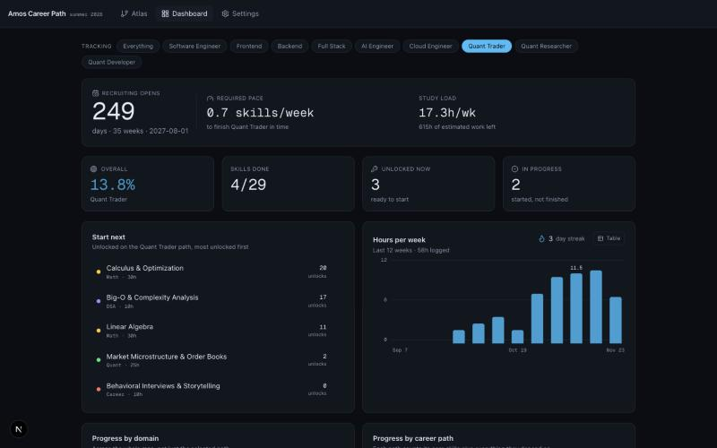

# Amos Career Path

A personal skill map for getting technically ready for **summer 2028 internship
recruiting**, which opens around **1 August 2027**. 97 skills across ten domains,
wired into a prerequisite graph, with nine career paths through it — software
engineering, AI, and the three quant tracks (trader, researcher, developer).

Everything is local: progress lives in `localStorage`, content lives in typed data
files in the repo.




> Both screenshots use sample progress. Replace them with your own by dropping new
> files over `docs/screenshots/atlas.jpg` and `docs/screenshots/dashboard.jpg`.

## Why I built this

*(Placeholder — rewrite this in your own words.)*

I kept a reading list, a LeetCode list, a half-finished Notion board and a vague
sense of what I "should" learn before applications open, and none of them told me
the one thing I actually wanted to know: **what should I work on today, and am I
moving fast enough?** A flat checklist cannot answer that, because skills are not
independent — stochastic calculus is pointless before probability, and low-latency
C++ is pointless before you understand memory.

So this models the dependencies explicitly. The map knows what is unlocked, the
dashboard knows how many weeks are left, and the recommendation list ranks what is
available by how much of the map it opens up. The proof-of-work list exists because
a skill I cannot point to a repo for is not a skill I can put on a resume.

## Features

**Atlas** — the graph
- Pan, zoom, minimap and fit-view over all 97 skills, laid out automatically
- Horizontal position comes from the prerequisite graph; each domain gets its own band
- Search with a `/` shortcut, arrow keys and Enter to jump straight to a skill
- Domain and career-path filter chips, which intersect rather than union
- Nodes carry status, domain colour, level, hour estimate and a resource progress bar
- Edges animate outward from a prerequisite once it is done
- Side panel: summary, clickable prerequisites and unlocks, resources grouped
  beginner → intermediate → advanced with checkboxes, markdown notes with a preview,
  a proof link, an hours log, and Start / Mark done
- Locked skills are still fully readable

**Dashboard**
- Countdown to the recruiting date and the pace needed to finish in time
- Overall %, skills done, unlocked now, in progress — scoped to the selected path
- "Start next": unlocked skills ranked by how many others they unlock
- Progress by domain and by career path
- Hours per week with a streak counter and a table view
- Proof of work: everything finished, with its link, newest first

**Settings**
- Editable recruiting target date
- Export progress as JSON, import it back, reset with an inline confirm

## Tech stack

| | |
|---|---|
| Framework | Next.js 16 (App Router), React 19 |
| Language | TypeScript, `strict`, no `any` |
| Styling | Tailwind CSS v4, dark by default |
| Graph | `@xyflow/react` (React Flow) 12, laid out with `dagre` |
| State | Zustand, persisted to `localStorage` |
| Icons | `lucide-react` |
| Tests | Vitest — 175 unit tests |
| Deploy | Vercel |

## Getting started

```bash
npm install
```

```bash
npm run dev
```

Then open <http://localhost:3000>.

| Script | What it does |
|---|---|
| `npm run dev` | Dev server |
| `npm run build` | Production build |
| `npm run test` | Vitest, once |
| `npm run test:watch` | Vitest, watching |
| `npm run typecheck` | `tsc --noEmit` |
| `npm run lint` | ESLint |
| `npm run check:links` | Verify every resource URL still resolves |

## How to add a skill

All content lives in typed data files under `src/data/`. Nothing is hardcoded in a
component.

1. Add an entry to `src/data/skills.ts`:

```ts
{
  id: "kalman-filters",              // kebab-case, unique, never changes
  name: "Kalman Filters",
  domain: "quant",                   // must be an id from domains.ts
  summary: "Recursive state estimation for noisy linear systems.",
  prerequisites: ["linear-algebra", "probability"],
  estHours: 20,
  level: 3,                          // 1 foundational, 2 intermediate, 3 advanced
}
```

2. Run the tests. They fail loudly if the id is duplicated, a prerequisite does not
   exist, the summary is missing, or the new edge creates a **cycle**:

```bash
npm run test
```

That is the whole job — the Atlas layout, the domain band, every path that
transitively depends on it, the progress maths and the recommendations all pick it
up automatically. Progress is keyed by skill id and stored separately, so adding or
editing content never touches what you have already completed.

To add a **domain**, add it to `src/data/domains.ts` (id, name, hex colour, Lucide
icon name) and register the icon in `src/components/DomainIcon.tsx`. Bands render in
the order domains are declared.

To add a **career path**, add it to `src/data/paths.ts` listing only its *core*
skills — the prerequisite closure is computed, so you never list the whole chain.

## How to add a resource

Add an entry to `src/data/resources.ts`:

```ts
{
  skillId: "kalman-filters",
  title: "Understanding Kalman Filters",
  creator: "Some Channel",
  url: "https://www.youtube.com/watch?v=…",
  type: "video",            // "video" | "playlist" | "course page" | "practice"
  level: "intermediate",    // "beginner" | "intermediate" | "advanced"
}
```

One resource that covers several skills goes through the `forSkills()` helper in
that file rather than being copy-pasted.

Then check it actually resolves:

```bash
npm run check:links
```

The checker verifies YouTube videos and playlists through the oEmbed endpoint, falls
back to reading the page's own `playabilityStatus` when oEmbed refuses (which happens
when the uploader has merely disabled embedding — the video is fine), and does
HEAD-then-GET for everything else. It prints a table and exits non-zero. **It never
edits or removes a link** — a dead link is a decision you make.

Skills with no curated link show an "add a resource" button instead. Links added
that way are stored with your progress, not in the repo.

## Project structure

```
src/
  app/                 routes: / (Atlas), /dashboard, /settings
  components/
    atlas/             graph canvas, nodes, filter bar, side panel
    dashboard/         stat tiles, meter lists, chart, proof list
    settings/          target date, export, import, reset
  data/                domains, skills, paths, resources  ← all content
  lib/                 graph logic, layout, dates, markdown, dashboard maths
  store/               Zustand progress store
scripts/
  check-links.ts       resource link checker
```

`src/lib/` is where the testable logic lives — status derivation, cycle detection,
path closure, progress maths, recommendation ranking, pace, streaks, layout and the
markdown parser are all pure functions with tests in `src/lib/__tests__/`.

## Deploying to Vercel

The app is fully static — no database, no API routes, no environment variables.

**From the dashboard**

1. Push this repo to GitHub.
2. At [vercel.com/new](https://vercel.com/new), import it.
3. Accept the defaults — Vercel detects Next.js, builds with `npm run build`, and
   serves from `.next`. There is nothing to configure.
4. Deploy.

**From the CLI**

```bash
npx vercel
```

```bash
npx vercel --prod
```

Because progress is per-browser `localStorage`, a deployed copy starts empty. To
move progress to it, export JSON from Settings on the old machine and import it on
the new one.

## Decisions

Non-obvious choices — layout algorithm, why filtering dims instead of hides, the
chart hue, why the markdown parser is hand-written — are written up in
[DECISIONS.md](DECISIONS.md).
